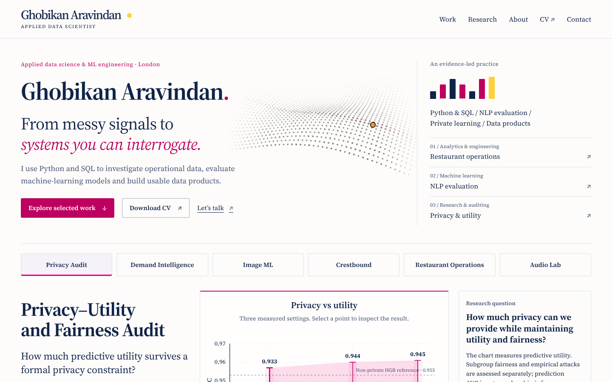

# Motion audit and premium animation pass — 3 November 2026

This pass audited the portfolio's existing native (WAAPI) motion system, then rebuilt it on **GSAP 3.15** (core, ScrollTrigger, SplitText, CustomEase) and added a **Three.js r187** hero field. The Gallery Proof identity is unchanged: navy ink, editorial pink, yellow for the selected observation, warm paper, self-hosted Source Serif 4. Every measurement, caveat and native disclosure still reads without JavaScript.

## 1. Design DNA: what the motion has to express

The motion is derived from tokens the site already had. Nothing was added for its own sake.

| Token | Value | Source / role |
| --- | --- | --- |
| Ink | `#102449` | Reading and plotting colour. Most field points. |
| Editorial pink | `#bd005f` | Actions and uncertainty. The field's ridge, and the pointer lens tint. |
| Selected yellow | `#ffd137` | Exactly one selected point, with an ink ring, as in the privacy and partition charts. |
| Ease out (entrances) | `cubic-bezier(.23, 1, .32, 1)` → GSAP `portfolio-out` | Arrivals begin fast and settle, so the interface responds at once. |
| Ease in-out (on-screen movement) | `cubic-bezier(.77, 0, .175, 1)` → `portfolio-in-out` | Chart lines drawing, the selection guide moving, the field resolving. |
| Feedback | 160ms press, 220ms selection | Kept under 300ms, so repeated use never waits on the interface. |
| Reveal | 600ms; headings 900ms masked lines | Hierarchy comes from mechanism (masked lines and characters vs fades), not just from duration. |
| Distance | 8–16px | Movement is small. Headings use a mask, not a longer travel. |
| Stagger | 85ms opening beats; 18ms characters; 35–60ms groups | Five ordered opening beats, as documented on 25 October. |

The thesis on the page is *"From messy signals to systems you can interrogate."* The hero field makes that literal. Scattered points resolve left to right into one ordered surface. A pink ridge runs across it, and a single yellow "selected" point sits on the ridge. The pointer can interrogate the surface locally. The field is decoration: it is `aria-hidden`, has no labels and implies no result (see the Evidence Colour Rule in `DESIGN.md`).

## 2. Audit of the previous motion (main `45cbce3`)

**Kept.** It already had a reduced-motion path (including live preference changes), one-shot reveals that unobserve on entry, focus cancelling ancestor movement, cancellation on page hide and back/forward-cache restore, static chart values that never count up, and native disclosures. All of these behaviours are kept.

| # | Finding | Evidence | Severity | Resolution |
| --- | --- | --- | --- | --- |
| A1 | **Opening flash.** The deferred script started the opening after first paint. Content could paint fully, then drop to 15% opacity and animate back. | old `assets/js/motion.js:28–37` | High (first impression) | An inline head script adds `motion-intro`, which holds only the opening. motion.js releases it in the same task that sets the from-states. A **3s failsafe** always removes it. No-JS, reduced-motion, deep-linked and back/forward visits never hide anything. |
| A2 | **One curve for everything.** `cubic-bezier(.16,1,.3,1)` also drove on-screen movement (the chart guide), where an ease-out feels abrupt at the end. | old `motion.js:11` | Medium | Two named curves: `portfolio-out` for entrances and `portfolio-in-out` for movement between two on-screen states. |
| A3 | **Flat entrance vocabulary.** Headings, paragraphs, panels and metadata all used translate + fade, separated only by 10–20px of travel. | old `motion.js:75–80` | Medium | The name reveals by character and the summary, section titles and project titles by line, all behind a clip mask. Body copy keeps the short lift. Splits are reverted as soon as they finish, so the DOM, text selection and screen-reader output are untouched afterwards. |
| A4 | **Menu not origin-aware.** The mobile menu slid down 12px from nowhere. | old `motion.js:53–57` | Low | It grows from the menu button's corner (`transform-origin: 100% 0`, scale .97 → 1, 200ms). Closing is instant, as native semantics expect. |
| A5 | **No press feedback.** Buttons, inspector controls and collection links changed tone on hover but gave no response on press. | `site.css` button rules | Medium | `:active` scales to .97 over 160ms. Removed under reduced motion. |
| A6 | **Sticky hover on touch.** The Crestbound brightness hover was not gated by pointer type. | old `site.css:1921` | Low | Hover is now gated by `(hover: hover) and (pointer: fine)`. |
| A7 | **Conflicting and dead declarations.** `.button` transitions were declared three times (`site.css:295`, `:1690`, `:1865`). The header `min-height` transition (`:168`) never ran, because compact and full heights are equal. | old `site.css` | Low | One final transition rule covers controls (colour, border, shadow, transform only). Older rules are left in place, because removing them is a separate, riskier stylesheet cleanup. |
| A8 | **Chart ordering.** The envelope and whiskers were already visible while the guide line drew over them. | old `motion.js:62–68` | Low | The line draws first (in-out, 800ms), then the envelope and whiskers fade in. Values never animate. |
| A9 | **Nothing anchored the hero's thesis.** There was empty space between identity and practice at desktop widths. | `index.html` hero | Opportunity | The Three.js signal field. |
| A10 | **Hidden while entering (regression found during this pass).** A first GSAP draft used `autoAlpha`. That sets `visibility:hidden` and makes links unfocusable mid-entrance, and the browser regression caught it on the mobile menu. | `scripts/browser_site.cjs` keyboard menu check | High (accessibility) | Interactive content now animates `opacity` only. `autoAlpha` is used only on the decorative field host. |

**Deliberately rejected:**
- Smooth-scroll hijacking (Lenis or ScrollSmoother). It overrides native scrolling, find-in-page and assistive technology for little gain.
- Custom cursors and magnetic buttons.
- Counting-up numbers, which `DESIGN.md` forbids.
- Perpetual idle loops.
- Animating evidence images or charts with parallax. Only the Crestbound game art moves.

## 3. What was built

### GSAP choreography (`assets/js/motion.js`)
- **Opening:** five beats at 85ms intervals: role (blur 4px → 0), name (characters rising behind a mask), summary (lines), description, actions. The practice bars grow (55ms stagger), then routes and the collection index arrive. The header settles in parallel. Total about 1.4s.
- **Scroll reveals:** `ScrollTrigger.batch` with `once: true`. Elements entering together are staggered (60ms, capped at 240ms). Anything already in view on a deep-linked or restored visit is marked as revealed and never moves.
- **Headings:** masked line reveals for project titles, section titles, Semantic Drift and the contact headline.
- **Charts and diagrams:** guides draw with in-out easing, followed by the envelope. Ordered diagram stages keep their reading-order stagger.
- **Crestbound art:** a clip-path inset opens on entry. A scrubbed ±3% parallax runs only at ≥761px with no reduced-motion preference, through `gsap.matchMedia`, which reverts it automatically when the preference changes.
- **Feedback:** privacy selection guide, dot and panel (220ms), evidence inspector (220ms), menu (200ms). These are ported from WAAPI with the same meaning.
- **Settling:** focus completes ancestor tweens. Reduced motion, a hidden page and `pagehide` complete everything and revert splits. Disclosures and fonts trigger a `ScrollTrigger.refresh()`.

### Three.js signal field (`tools/motion/signal-field.src.js` → `assets/js/signal-field.js`)
- 1,740 points (58×30) in one `Points` draw call with a small custom shader. The sweep, ridge tint, pointer lens and the yellow point's ink ring are all computed on the GPU.
- **On-demand rendering:** a frame is drawn only when a GSAP tween changes a uniform (the 2.6s arrival, the pointer `quickTo`s, the scrubbed scroll). The regression asserts that the frame counter stays still while the page is idle.
- **Loaded lazily:** a dynamic `import()` after `load` plus idle time. It loads only at ≥1024px, with WebGL2, without Save-Data and with ≥4GB device memory. It is never on the critical path, and phones never download it.
- **Reduced motion:** renders the resolved surface once and ignores pointer and scroll input. The surface also settles if the preference changes mid-arrival.
- Handles WebGL context loss by removing itself. ResizeObserver keeps it sharp, with pixel ratio capped at 2.

## 4. Weight

| File | Minified | gzip | Loaded |
| --- | ---: | ---: | --- |
| `assets/vendor/gsap/gsap.min.js` | 71.2 KB | 27.8 KB | deferred, all widths |
| `assets/vendor/gsap/ScrollTrigger.min.js` | 43.5 KB | 17.6 KB | deferred, all widths |
| `assets/vendor/gsap/SplitText.min.js` | 7.6 KB | 3.6 KB | deferred, all widths |
| `assets/vendor/gsap/CustomEase.min.js` | 7.0 KB | 3.6 KB | deferred, all widths |
| `assets/js/signal-field.js` (Three.js, tree-shaken) | 527.7 KB | 133.0 KB | lazy, desktop only, after `load` |

GSAP is vendored, not loaded from a CDN, so the site still loads no remote script. That is enforced by `test_motion_libraries_are_vendored_and_ordered`. The website still has no runtime npm step: `tools/motion/` is build-time only, and its outputs are committed.

## 5. Verification

- `python scripts/build_site.py` and `python scripts/test_site.py`: 18 structural tests, including the new vendoring/ordering test and a scoped no-hidden-content check that permits `opacity:0` only under `.motion-intro`, with the failsafe asserted.
- `node --check` on every production script.
- `scripts/browser_site.cjs` (updated for GSAP) at 320, 375, 390, 768, 1024, 1440 and 1920px. It checks:
  - the five opening beats at 0/85/170/255/340ms
  - the `motion-intro` class released and the split text reverted
  - the field mounting only at ≥1024px, `aria-hidden`, with no frames while idle
  - one-shot reveals with no replay
  - keyboard menu, chart and inspector checks, every disclosure, overflow, fonts, images and console errors
  - live and initial reduced motion: no running WAAPI animations or GSAP tweens, and the pointer cannot move the field
  - no-JS pages and all seven case-study deep links
- Visual frames of the opening and the pointer lens were captured in headless Chromium (SwiftShader WebGL) at 1440px.

**Not covered:** physical devices, Safari and Firefox, a GPU-backed (non-SwiftShader) frame-time profile, and a fresh Lighthouse run. Lighthouse should be re-measured on the deployed GitHub Pages build. Cold mobile LCP was already the main opportunity, and this pass adds about 53 KB gzip of deferred GSAP.

## 6. Rebuilding the field or updating GSAP

```bash
cd tools/motion
npm ci
npm run build
```

`build.mjs` re-bundles the field and copies GSAP's unmodified `dist` files with a licence note. Bump the `?v=` query strings in `index.html` when they change.

## 7. Screenshots

These are headless Chromium captures of the implementation at 1440px, not mockups: [settled hero](review/2026-11-03/hero-settled-1440.png), [pointer lens](review/2026-11-03/hero-pointer-1440.png), [opening sequence, four frames](review/2026-11-03/opening-sequence.png) and [browser results](review/2026-11-03/browser-results.json).



## 8. Follow-up, 5 November: "not animated or dynamic"

After deployment, the owner reported the site did not feel animated. On the live site at 1440px, GSAP was active, the field rendered 81 frames and there were no console errors. So the system worked, but as designed it played once and then went still, its effects were small, and phones never saw the field. The owner chose "clearly alive". `DESIGN.md` → *Living motion* records the new rules. In short:

- **The field loops**, paused off screen, in hidden tabs and under reduced motion. It has travelling waves, a signal pulse, a breathing selected point, a cursor lens with ripples, and scroll scatter. A 40×22 point version runs on phones and tablets, in a band reserved before paint.
- **Scrubbed scroll depth:** panel travel, title and heading drift, the contact scale, image parallax and scroll-speed bars.
- **Chart marks and masked figure reveals** on arrival. Exact values only.
- **A pointer spotlight** on evidence panels.

The browser regression now asserts that the field renders on screen, stops rendering when scrolled away, and stays still under reduced motion.


Screenshots: [desktop with cursor lens](review/2026-11-05/hero-alive-1440.png), [tablet band](review/2026-11-05/hero-alive-820.png), [phone band](review/2026-11-05/hero-alive-390.png), [browser results](review/2026-11-05/browser-results.json).
