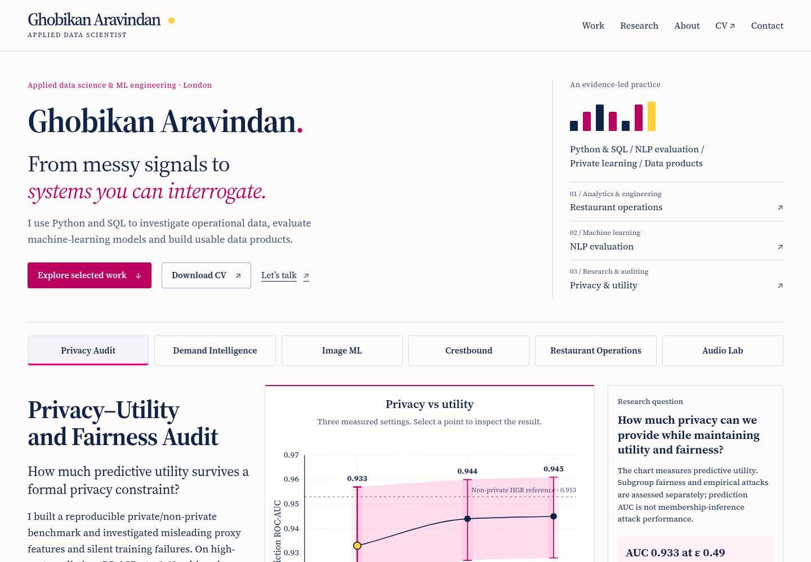

# Portfolio motion and recruitment readiness — 25 October 2026

The opening now identifies Ghobikan, his applied data science / ML engineering focus and Python/SQL practice, with immediate work, CV and contact actions. The editorial paper/ink/pink palette, local fonts, evidence-led projects and static GitHub Pages architecture remain.

## Audit and implementation

Reviewed main `f46a4b1`, PR #7 head `8d44dc4` and PR #5's fetched head. Main already implements PR #5's inspectors, partition comparisons, active collection navigation, reading progress and interruptible native disclosures. Re-merging that branch would duplicate interactions and revive obsolete selectors. Its useful principles were extended in place.

PR #7's recruiter framing and evidence corrections were useful, but its introductory prose needed a clearer visual hierarchy and stronger CV/contact actions. Its NLP metrics were checked against the current source report and adopted with development-only qualifications. Its PBIX warning was retained. No new right-to-work or credential claim was added; the existing CV remains byte-for-byte unchanged.

The original opening had a visually hidden identity heading and immediately entered the privacy study. Motion was concentrated in that study and a few diagrams. The new opening separates identity from project evidence, then routes visitors into three relevant disciplines and the complete collection index. Evidence panels have restrained project accents and a 3px pointer lift; focus uses tone/border changes.

The motion system uses native WAAPI and IntersectionObserver: 560ms reveals, 85ms opening staggers, 12–20px movement, 700ms chart drawing and 220ms interaction feedback. Headings, descriptions, metadata, charts and ordered stages have different choreography. Targets unobserve on first entrance. No content is hidden by default, exact measurements never count up and no continuous animation loop is introduced. Focus and reduced-motion changes cancel effects. Page hiding/exit cancels animations; pending observer targets reconnect after back/forward-cache restoration.

Crestbound's two consumers and Audio Lab's deterministic pipeline now use the existing keyboard inspector pattern. Privacy selections update stable SVG nodes instead of rebuilding the chart; the guide moves between real settings while labels update directly. Uncertainty and interpolation caveats remain. Anchor spacing now combines one header allowance with a 12px margin instead of two 100px offsets.

## Screenshots

Captured from the same local build workflow in Chromium, viewport height 1000px, scale factor 1. Baseline is the fetched main snapshot; final captures wait for opening animation and local fonts. These are screenshots of the implementation, not mockups.

| View | Before | After |
| --- | --- | --- |
| Desktop, 1440px | [Before](review/2026-10-25/before-1440.png) | [After](review/2026-10-25/after-1440.png) |
| Phone, 390px | [Before](review/2026-10-25/before-390.png) | [After](review/2026-10-25/after-390.png) |

[Image ML](review/2026-10-25/image-ml-1440.png) · [Crestbound](review/2026-10-25/crestbound-1440.png)

## Executed validation

- Build and 17 structural regressions passed; all three production JavaScript files passed Node syntax checks. The builder's existing idempotence, unchanged CV and Pages-prefix checks remain.
- `scripts/browser_site.cjs` passed at **320, 375, 390, 768, 1024, 1440 and 1920px**. Each width exercised disclosures, diagram controls, privacy points/axis, keyboard interaction, one-shot scroll reveals, fonts/images, overflow and JavaScript/console errors. No overflow or browser errors were observed with all disclosures expanded.
- Opening WAAPI instrumentation confirmed five ordered 85ms entrance delays. Re-entering the image-ML heading did not replay its reveal.
- Initial reduced motion, changing to reduced motion during the opening and offscreen navigation under reduced motion produced no running motion. Native disclosures remained usable.
- No-JavaScript checks at 320/1440px verified visible identity/navigation, exact privacy values and native disclosure activation. A separate check with WAAPI and IntersectionObserver unavailable also retained working content/disclosures without errors.
- All seven legacy case-study bookmarks open their target; sticky-header clearance and browser back navigation passed. Mobile menu Enter/Tab/Escape behavior and focus return passed.
- axe WCAG 2 A/AA + 2.1 AA checks at 390/1440px with every case study open found **zero violations**. Automated checks do not establish complete screen-reader usability.
- Optional external link probing reached public GitHub sources. Streamlit, GitHub Pages, LinkedIn and the restaurant domain were blocked by this environment's egress proxy; those external destinations remain unverified here. Local CV, site assets and internal pages are verified.

[Browser results](review/2026-10-25/browser-results.json) · [axe summary](review/2026-10-25/axe-summary.json)

## Measured performance

Lighthouse 13.4.0, headless Chromium, localhost Python static server, default simulated mobile throttling / desktop preset. Main and updated site were measured separately; these are individual lab navigation runs, not production field measurements or statistical comparisons. Local HTTP is uncompressed and differs from GitHub Pages delivery. Complete raw outputs remain in `/workspace/portfolio-review`; the committed summary records timestamps, settings, browser identity and metrics.

| Metric | Main mobile | Updated mobile | Main desktop | Updated desktop |
| --- | ---: | ---: | ---: | ---: |
| Performance | 89 | 88 | 100 | 100 |
| Accessibility | 100 | 100 | 100 | 100 |
| Best practices | 100 | 100 | 100 | 100 |
| SEO | 100 | 100 | 100 | 100 |
| FCP | 2.3s | 2.3s | 0.6s | 0.5s |
| LCP | 3.4s | 3.5s | 0.7s | 0.7s |
| Speed index | 2.7s | 2.3s | 0.6s | 0.5s |
| Total blocking time | 0ms | 0ms | 0ms | 0ms |
| Cumulative layout shift | 0 | 0 | 0 | 0 |

[Measured settings and results](review/2026-10-25/lighthouse-summary.json)

The updated mobile run costs one score point and about 0.1s simulated LCP, while its speed index improves. This is not evidence of a production improvement or of equivalent performance under every condition. Cold mobile LCP remains an optimization opportunity, primarily around render-blocking styling and font delivery; no verification was disabled to improve scores. INP is not measured by these navigation runs. Physical devices, Safari/Firefox and assistive-technology sessions remain outside the executed coverage. No deployment, project experiment rerun, native Power BI validation or live payment acceptance test was performed.

## Reuse

Build with `python scripts/build_site.py`, validate with `python scripts/test_site.py`, then serve `_site` using `python -m http.server 8000 --directory _site`. Run `REVIEW_DIR=/tmp/portfolio-review node scripts/browser_site.cjs` with Playwright available and Chromium at `/usr/bin/chromium` (override `CHROME_PATH`/`SITE_URL` as needed). The website has no new runtime dependency. Motion extension rules are documented in [DESIGN.md](../DESIGN.md).
